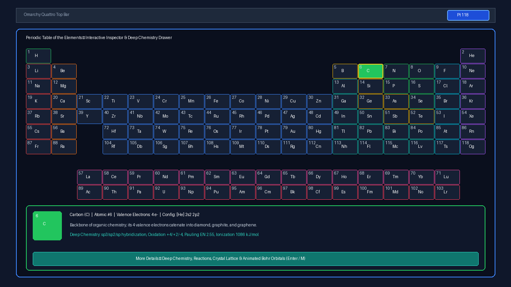

# Periodic Table for Omarchy Quattro (`io.github.advocatus.periodic-table`)

An interactive, educational **Periodic Table of the Elements** top-bar plugin for **Omarchy Quattro (`omarchy-shell`)**. Click the top-bar icon (`⚛ Pt`) to open an anchored 18×10 periodic table popup where hovering or navigating with arrow/Vim keys immediately displays core element facts and **valence electrons**, and clicking **More Details** (`Enter` or `M`) unfolds an interactive **Deep Chemistry & Animated Bohr Orbitals Drawer**.



## Features

- **Top-Bar Widget & Instant Popup (`BarWidget.qml` + `Panel.qml`):** Lives inside `omarchy-shell` with zero external process spawn latency.
- **Easy-to-Read 18×10 Element Grid:** Every tile clearly displays the atomic number, valence electron count (`e⁻`), bold element symbol, and element name, color-coded by IUPAC chemical family.
- **Stage 1 — Live Hover & Keyboard Inspector Card:** Hovering the cursor or navigating with `← ↓ ↑ →` / `h j k l` updates the bottom inspector card in real time with the element's atomic number, mass, **number of valence electrons**, electron configuration, Bohr shell array, period/group/block, phase state, and a memorable real-world summary.
- **Stage 2 — "More Details" Deep Chemistry Drawer:** Clicking the bottom **More Details** button on any element card (or pressing `Enter` / `M`) opens the deep chemistry view featuring:
  - **Animated 2D Bohr Orbital Visualizer (`BohrCanvas.qml`):** Hardware-accelerated QML `Canvas` showing concentric K–Q electron shells with highlighted outer valence electrons.
  - **Chemical Reactivity & Bonding Profile:** Signature chemical reactions, hybridization/bonding behavior, oxidation states, Pauling electronegativity, first ionization energy, covalent radius, crystal lattice geometry, and melting/boiling points.
- **Interactive Learning Modes:**
  - **Property Heatmaps (`V`):** Cycle tile colors between Chemical Family, Valence Electrons, Pauling Electronegativity, and Atomic Radius.
  - **Temperature Phase Explorer (`T`):** Switch temperatures from Absolute Zero (`4 K`) to the Solar Surface (`5,800 K`) to watch elements transition between Solid, Liquid, and Gas.
  - **Flash Quiz Mode (`Q`):** Test your chemistry knowledge by identifying elements from their valence electron counts and electron configuration clues.

## Dependencies & Security Posture

- **Zero external dependencies:** Built 100% in native Qt6 / Quickshell QML and a static `.pragma library` JavaScript dataset (`ElementsData.js`).
- **Zero privilege boundaries, installers, or background daemons:** No `sudo`, no network requests, no shell subprocesses, and no external setup scripts.

## Install

```sh
omarchy plugin add https://github.com/advocatus/omarchy-periodic-table.git --enable
```

*(If forked under your own GitHub username, replace `advocatus` with your GitHub username.)*

## Usage & Keyboard Shortcuts

Click **`⚛ Pt`** in the Omarchy top bar (or summon via IPC) to toggle the periodic table popup:

| Key / Action | Effect |
| :--- | :--- |
| **Mouse Hover** or **`← ↓ ↑ →` / `h j k l`** | Select any element and update the Stage 1 Live Element Inspector Card |
| **Click `More Details`** or **`Enter` / `M`** | Toggle the Stage 2 **More Details** Deep Chemistry & Bohr Orbitals Drawer |
| **`V`** | Cycle color heatmaps (Chemical Family → Valence Electrons → Electronegativity → Atomic Radius) |
| **`T`** | Toggle the Kelvin Temperature Phase Explorer bar (`4 K` – `5,800 K`) |
| **`Q`** | Toggle the interactive Flash Quiz mode |
| **`Esc`** | Collapse the **More Details** drawer (if open) or close the popup panel |

## Configure

Move the widget to any top-bar section (`left`, `centerBegin`, `center`, `centerEnd`, `tray`, or `right`):

```sh
omarchy bar move io.github.advocatus.periodic-table --section right
```

Summon or hide the popup via CLI / hotkey:

```sh
omarchy-shell shell summon io.github.advocatus.periodic-table '{}'
omarchy-shell shell hide io.github.advocatus.periodic-table
```

## Validate Locally

```sh
PLUGIN_ID="io.github.advocatus.periodic-table"
PLUGIN_DIR="$HOME/.config/omarchy/plugins/$PLUGIN_ID"
omarchy plugin validate "$PLUGIN_DIR"
qmllint -I "$OMARCHY_PATH/shell" "$PLUGIN_DIR/BarWidget.qml" "$PLUGIN_DIR/Panel.qml" "$PLUGIN_DIR/BohrCanvas.qml"
```

## Remove

```sh
omarchy plugin remove io.github.advocatus.periodic-table
```

## License

MIT License — see [LICENSE](LICENSE).
